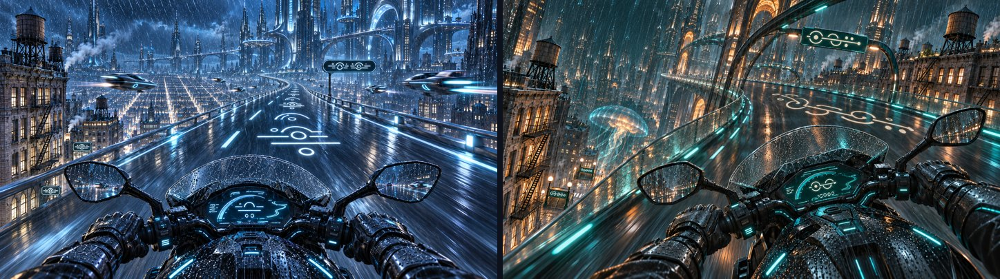
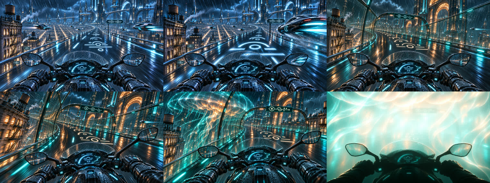
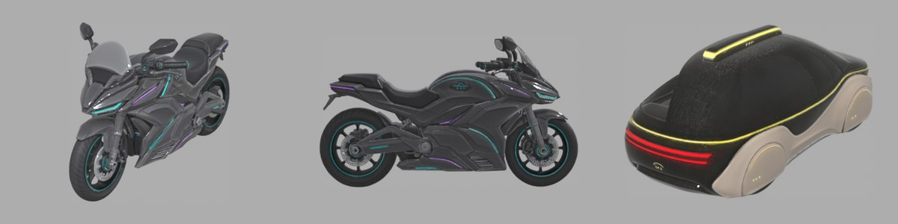
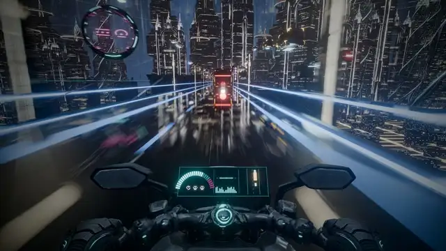
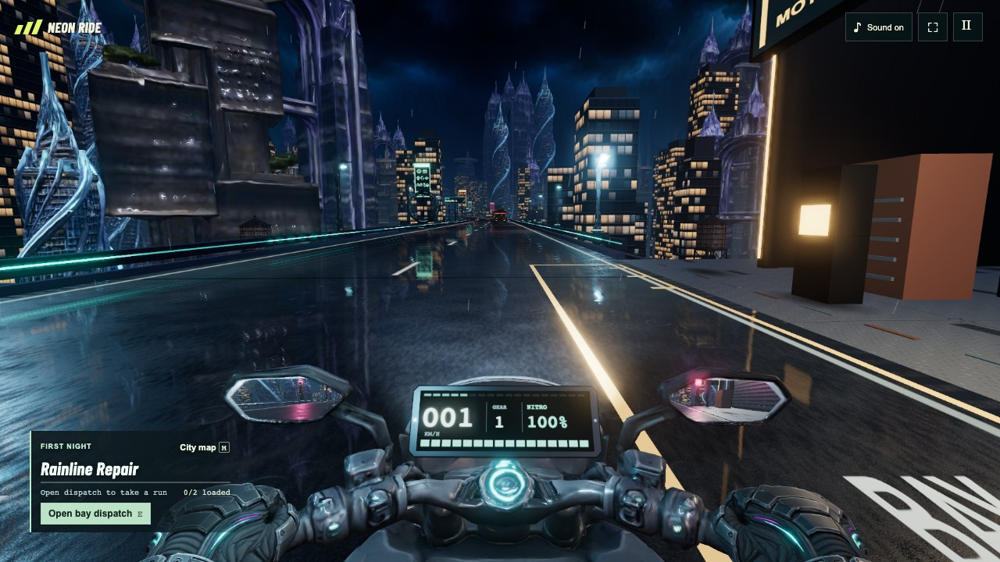

# Neon Ride

A twenty-second Blender film grew into a motorcycle courier game. The way to see what changed is to watch the ride, then take the handlebars yourself.

**[▶ Play Night Courier](https://neon-ride-orpin.vercel.app/)** · **[↓ Get the original film with sound (MP4)](https://raw.githubusercontent.com/comountainclimber/neon-ride/main/renders/neon-ride-final.mp4)** · [Controls and build instructions](#ride-the-night-shift)

## From concept art to Night Courier

### 01 · Draw the route

Six rounds of concept art narrowed the ride to two views. On the open skyway you can see the street grid far below. In the glass-walled turn, the jellyfish hologram almost fills the rider’s field of view.

[](concepts/)

### 02 · Storyboard the pass

The film is one continuous shot. These six boards set the timing of the traffic passing the rider, the jellyfish reveal and the lean into the last bend. Watch the handlebars across the bottom of the frames.

[](storyboard/)

### 03 · Put the drawings on wheels

The bike started with front, rear and side drawings. Tripo turned the references into textured GLBs. These Blender inspection renders show the bike from two angles and the cab it passes on the skyway. The mirrors and fairing are easier to spot here than at speed.

[](models/)

[Bike reference drawings](refs/bike-sheet.jpg) · [3D models](models/) · [Blender inspection script](scripts/inspect_glb.py)

### 04 · Render the twenty-second film

A Python script places the road, traffic and camera in Blender. The jellyfish has its own animation, and the instrument panel follows the ride. The final pass adds rain, passing-vehicle sounds and a second of black at the end.

<a href="https://raw.githubusercontent.com/comountainclimber/neon-ride/main/renders/neon-ride-final.mp4">
  <picture>
    <source media="(prefers-reduced-motion: reduce)" srcset="docs/timeline/film-still.jpg">
    
  </picture>
</a>

[Full film with sound · 1080p MP4](https://raw.githubusercontent.com/comountainclimber/neon-ride/main/renders/neon-ride-final.mp4) · [Full-resolution stills](docs/final_sheet.png) · [Scene script](scripts/build_ride.py)

### 05 · Hand the route to the player

The first Unreal prototype put the film bike on a skyway you could steer. The city grew into three connected districts, with dispatch jobs, delivery windows and a film reel bound for Aurora Cinema. The browser and Unreal editions share the C++ driving and courier rules. Here’s the view from the saddle outside Rainline Repair.

[](https://neon-ride-orpin.vercel.app/)

**[▶ Take the night shift](https://neon-ride-orpin.vercel.app/)** · [Browser source](web/) · [Unreal project](unreal/NeonRide/) · [Original film-to-game brief](UNREAL_HANDOFF.md)

## Ride the night shift

Play Vesper's motorcycle courier shift in the browser or Unreal Engine 5.8.4 on Windows. The 5.28 km express ring connects Rainline's streets, the Floodworks Canal and the loading docks in Glass Heights. The entire road network covers 11.51 km. Ride in the right lane at a signed exit to take the branch. The center and left lanes continue ahead.

Start at Rainline Repair. Open dispatch, reserve up to two parcels and collect them from the saddle. Ride to the named business, pull into the right lane at walking speed and hand the parcel to its recipient. Select an address on the city map for guidance. Express parcels have a delivery window that starts at pickup. Late parcels can still be delivered. Returning clients remember your deliveries, and Sol opens the Aurora service ramp after the first cinema delivery.

Each shift offers eight contracts. Finish First Night, Regular Service and First Light to bring the dawn screening to Aurora Cinema. Keep riding and taking new shifts afterwards. The six original Tripo client models double as the Unreal import sources in `web/assets/models/`.

W/S accelerate and brake, A/D turn the bike, and Shift fires the rechargeable nitro tank. Centering the steering holds the current heading, including on bends. The cockpit gauge shows the remaining charge.

Traffic and guardrails respond to the angle and closing speed of contact. A scrape costs speed. A hard impact separates Vesper from the bike, and each carries its own momentum into the landing, bounce and slide. When they come to rest, walk back to the fallen motorcycle and remount within 2.4 metres. Use WASD and E on keyboard, the left stick and lower face button on a controller, or the walking pad and Remount button on touch. Vesper keeps her parcels. Timed deliveries keep counting during the walk, and saving on foot preserves both landing positions.

Both sets of handlebar mirrors show the road behind the bike. On a phone, slide the steering pad with one thumb and hold throttle, brake or nitro with the other. Double-tap the road to face forward. The pause menu lets you swap the steering thumb and adjust rendering resolution.

- [Play on Vercel](https://neon-ride-orpin.vercel.app) · [Browser source and assets](web/) · [Unreal project and build instructions](unreal/NeonRide/)
- To run locally, serve `web/` with `python -m http.server 8000 --directory web`, then open `http://localhost:8000`.
- GitHub deploys the `web/` directory to the linked Vercel project on updates to `main`.
- The four-layer motorcycle mix uses real motorcycle recordings by dklon and a Kenney turbine layer. [Audio credits and licenses](web/assets/audio/engine-credits.txt)

Both editions use the same C++ driving and courier rules in `unreal/NeonRide/Source/NeonRide/`. With Zig 0.14.1 on PATH, run `python unreal/NeonRide/Tools/build_circuit_wasm.py` after changing them. Run the same command with `--check` to verify the packaged module. Run `node unreal/NeonRide/Tools/check_courier.mjs web/circuit.js` to drive the delivery regression. The original and courier scenery manifests also ship with Unreal.

## How it was made

1. **Concept art**: GPT images generated through the Codex CLI from the prompts in `scripts/prompts/`.
   Six rounds of boards are in `concepts/`; the locked storyboard is in `storyboard/`.
2. **Asset drawings**: one clean reference per object (`concepts/`, `refs/`).
3. **3D models**: each drawing went through Tripo image-to-3D and came back as a textured GLB (`models/`).
4. **Scene**: `scripts/build_ride.py` builds the whole film in Blender from code: route, skyway, city,
   traffic, rain, lights, camera, riding motion. `scripts/jelly.py` is the procedural hologram jellyfish and
   `scripts/hud.py` the live instrument panel.
5. **Sound**: `scripts/mix_audio.py` mixes real CC0 recordings (`audio/wav/`) into `audio/soundtrack.wav`,
   timed to the same speed profile and pass times as the picture.
6. **Render**: Blender 5.3 Eevee, headless, on a rented GPU; ffmpeg joins frames and sound.

## Layout

| Path | What it holds |
| --- | --- |
| `scripts/build_ride.py` | The scene, animation and render settings. Source of truth for every number in the film. |
| `scripts/jelly.py`, `scripts/hud.py` | Procedural jellyfish hologram and dash display, imported by `build_ride.py`. |
| `scripts/mix_audio.py` | Soundtrack mix (numpy only). `make_audio.py` is an older synthesized version, unused. |
| `scripts/prompts/` | Every image prompt used for concepts, asset sheets, textures and glyphs. |
| `models/` | 18 Tripo GLBs: bike, glove, 4 flying cars, 3 towers, 3 signs, 2 lampposts, cab, truck, water tower, building crown. |
| `textures/`, `signs/` | Painted textures (road, facades, skyline backdrops) and the glyph alphabet sheet and words. |
| `concepts/`, `refs/`, `storyboard/` | Concept rounds, model reference views and the six storyboard frames. |
| `audio/` | Source downloads (`src/`), 48 kHz WAVs used in the mix (`wav/`), and the finished `soundtrack.wav`. |

## Rebuilding the film

Needs Blender 5.3 and ffmpeg.

```sh
# three test frames at half resolution
blender -b --python scripts/build_ride.py -- --frames 1,97,193 --res 50 --samples 16

# full animation at 1080p (about 20 minutes on a large GPU, far longer on a laptop)
blender -b --python scripts/build_ride.py -- --anim --res 100 --samples 48 --out renders/final

# soundtrack (any Python with numpy; Blender's bundled Python works)
python3 scripts/mix_audio.py

# join picture and sound
ffmpeg -framerate 24 -i renders/final/f_%04d.png -i audio/soundtrack.wav \
  -vf "vignette=PI/5,tpad=stop_mode=add:stop_duration=1:color=black" \
  -c:v libx264 -pix_fmt yuv420p -crf 15 -c:a aac -b:a 256k renders/neon-ride-final.mp4
```

## Credits

- Sound: CC0 recordings from OpenGameArt: Rain (loopable), Rain on Window Loop, wind1, wind whoosh loop,
  Space Winds, Ghostly Humming, Rain + Long Thunder, and Kenney's Sci-Fi Sounds.
- Images: generated with GPT image models. Models: generated with Tripo from those images.
