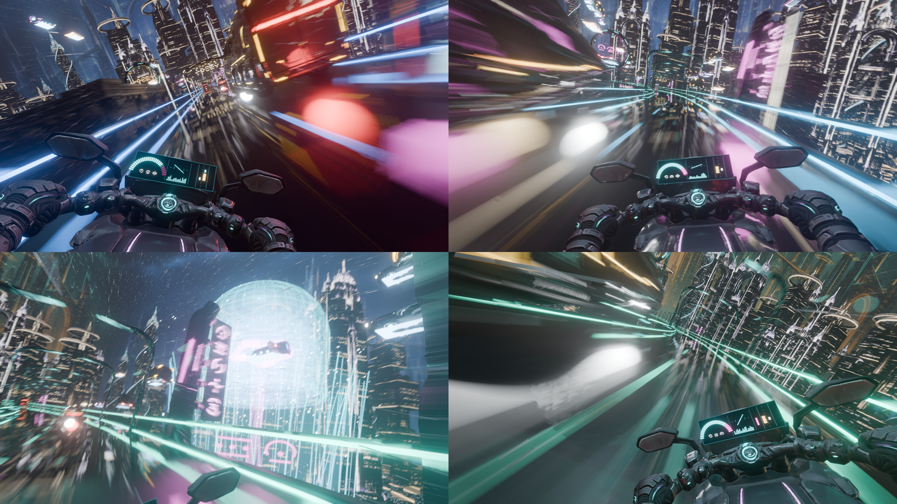

# Neon Ride

A 20-second first-person short: a motorcycle ride down a rain-soaked skyway above a far-future city,
weaving past cabs and freighter trucks, past a giant hologram jellyfish advert and into a glass-walled
left curve.

- Finished film: [`renders/neon-ride-final.mp4`](renders/neon-ride-final.mp4) (1080p, 24 fps, 20 s + 1 s black, with sound)
- Stills: [`docs/final_sheet.png`](docs/final_sheet.png)
- Next step, a playable Unreal Engine build: see [`UNREAL_HANDOFF.md`](UNREAL_HANDOFF.md)



## How it was made

1. **Concept art**: GPT images generated through the Codex CLI from the prompts in `scripts/prompts/`.
   Six rounds of boards are in `concepts/`; the locked storyboard is in `storyboard/`.
2. **Asset drawings**: one clean reference per object (`concepts/`, `refs/`).
3. **3D models**: each drawing went through Tripo image-to-3D and came back as a textured GLB (`models/`).
4. **Scene**: `scripts/build_ride.py` builds the whole film in Blender from code: route, skyway, city,
   traffic, rain, lights, camera, riding motion. `scripts/jelly.py` is the procedural hologram jellyfish and
   `scripts/hud.py` the live instrument panel.
5. **Sound**: `scripts/mix_audio.py` mixes real CC0 recordings (`audio/wav/`) into `audio/soundtrack.wav`,
   timed to the same speed profile and pass times as the picture.
6. **Render**: Blender 5.3 Eevee, headless, on a rented GPU; ffmpeg joins frames and sound.

## Layout

| Path | What it holds |
| --- | --- |
| `scripts/build_ride.py` | The scene, animation and render settings. Source of truth for every number in the film. |
| `scripts/jelly.py`, `scripts/hud.py` | Procedural jellyfish hologram and dash display, imported by `build_ride.py`. |
| `scripts/mix_audio.py` | Soundtrack mix (numpy only). `make_audio.py` is an older synthesized version, unused. |
| `scripts/prompts/` | Every image prompt used for concepts, asset sheets, textures and glyphs. |
| `models/` | 18 Tripo GLBs: bike, glove, 4 flying cars, 3 towers, 3 signs, 2 lampposts, cab, truck, water tower, building crown. |
| `textures/`, `signs/` | Painted textures (road, facades, skyline backdrops) and the glyph alphabet sheet and words. |
| `concepts/`, `refs/`, `storyboard/` | Concept rounds, model reference views and the six storyboard frames. |
| `audio/` | Source downloads (`src/`), 48 kHz WAVs used in the mix (`wav/`), and the finished `soundtrack.wav`. |

## Rebuilding the film

Needs Blender 5.3 and ffmpeg.

```sh
# three test frames at half resolution
blender -b --python scripts/build_ride.py -- --frames 1,97,193 --res 50 --samples 16

# full animation at 1080p (about 20 minutes on a large GPU, far longer on a laptop)
blender -b --python scripts/build_ride.py -- --anim --res 100 --samples 48 --out renders/final

# soundtrack (any Python with numpy; Blender's bundled Python works)
python3 scripts/mix_audio.py

# join picture and sound
ffmpeg -framerate 24 -i renders/final/f_%04d.png -i audio/soundtrack.wav \
  -vf "vignette=PI/5,tpad=stop_mode=add:stop_duration=1:color=black" \
  -c:v libx264 -pix_fmt yuv420p -crf 15 -c:a aac -b:a 256k renders/neon-ride-final.mp4
```

## Credits

- Sound: CC0 recordings from OpenGameArt: Rain (loopable), Rain on Window Loop, wind1, wind whoosh loop,
  Space Winds, Ghostly Humming, Rain + Long Thunder, and Kenney's Sci-Fi Sounds.
- Images: generated with GPT image models. Models: generated with Tripo from those images.
